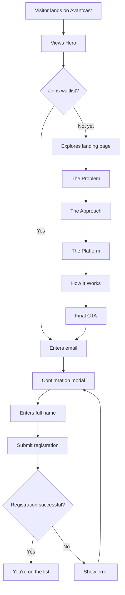

# AVANTCAST — LANDING PAGE BIBLE

## Structure, logique UX, contenu éditorial et spécifications UI

**Document de référence — Version 2.0**

**Objectif :** définir précisément la structure de la landing page Avantcast, sa narration, les textes à afficher, la composition des interfaces et les comportements attendus. Ce document sert de référence pour le travail Figma, le prototype et l'implémentation front-end.

---

# 1. Vision générale de la landing page

## 1.1. Rôle de la page

La landing page doit présenter Avantcast comme une plateforme de gestion et de planification financière personnelle.

Sa promesse centrale :

**Your money has a future. Make a plan for it.**

Avantcast aide l'utilisateur à dépasser le simple suivi de ses finances pour mieux comprendre sa situation patrimoniale, explorer différentes trajectoires financières et organiser ses décisions autour de ses objectifs.

La plateforme doit permettre de :

- Réunir les informations relatives à sa situation financière.
- Comprendre sa situation actuelle à travers des données et des indicateurs.
- Analyser l'évolution de son patrimoine.
- Définir des objectifs financiers personnels.
- Explorer différents scénarios et trajectoires possibles.
- Suivre sa progression et ajuster ses hypothèses.

La landing page ne doit pas positionner Avantcast comme une simple application de suivi des dépenses, un agrégateur bancaire ou un outil de gestion de budget traditionnel.

Le positionnement doit faire ressortir une progression :

**Financial information → Understanding → Planning → Decisions → Progress.**

## 1.2. Objectifs de conversion

La page remplit deux fonctions principales.

**1. Expliquer la proposition de valeur**

Faire comprendre pourquoi connaître ses dépenses ne suffit pas toujours à comprendre sa situation financière et comment Avantcast propose une approche plus prospective.

**2. Convertir**

Inciter le visiteur à rejoindre la waitlist afin de recevoir les informations relatives à l'accès anticipé.

L'inscription doit rester accessible à tout moment, sans obliger le visiteur à parcourir l'ensemble de la page.

## 1.3. Parcours narratif

La landing page suit une progression en six sections principales.

| Ordre | Section | Question à laquelle elle répond |
|---|---|---|
| 01 | Hero — The Promise | Quelle valeur Avantcast peut-il m'apporter ? |
| 02 | The Problem — The Missing Picture | Pourquoi suivre mes dépenses ne suffit-il pas ? |
| 03 | The Approach — From Tracking to Planning | Comment passer de la compréhension à la planification ? |
| 04 | The Platform — Five Connected Capabilities | Quelles capacités rendent cette approche possible ? |
| 05 | How It Works — From Data to Decisions | Comment vais-je utiliser Avantcast ? |
| 06 | Final CTA — Early Access | Comment obtenir un accès anticipé ? |

Le Header et le Footer complètent cette architecture.

**Logique de narration :**

> Promesse → Problème → Nouvelle approche → Capacités du produit → Parcours d'utilisation → Inscription.

Chaque section doit répondre à une question et préparer naturellement la suivante.

La page doit rester compréhensible même si le visiteur ne lit pas chaque paragraphe. Les titres, les aperçus de l'interface et la hiérarchie visuelle doivent transmettre l'essentiel du message.

## 1.4. Principes de conception

### Montrer avant de sur-expliquer

Les interfaces, graphiques, tableaux et aperçus du produit doivent rendre la proposition de valeur tangible. Le texte complète le visuel, il ne doit pas tout porter à lui seul.

### Une section = une idée principale

Éviter de répéter la même promesse avec des formulations différentes.

### Distinguer fonctionnalités et bénéfices

- Fonctionnalité : ce que le produit permet de faire.
- Bénéfice : pourquoi cette capacité est utile à l'utilisateur.

Exemple :

- Fonctionnalité : Scenario Simulation.
- Bénéfice : explorer les conséquences possibles de différentes hypothèses financières.

### Garder une promesse crédible

Ne pas présenter comme disponibles des fonctionnalités encore en développement ou simplement envisagées. Les maquettes doivent être identifiées comme des aperçus illustratifs lorsque nécessaire.

### Limiter la friction

Le visiteur doit pouvoir rejoindre la waitlist sans devoir parcourir toute la page ni remplir un formulaire long.

### Cohérence visuelle

Toutes les sections doivent partager les mêmes règles de typographie, d'espacement, de bordures, de rayons, de composants et de comportement.

---

# 2. Architecture globale et navigation

## 2.1. Ordre des sections

1. Header / Navigation
2. Hero — The Promise
3. The Problem — The Missing Picture
4. The Approach — From Tracking to Planning
5. The Platform — Five Connected Capabilities
6. How It Works — From Data to Decisions
7. Final CTA — Early Access
8. Footer

La section Comparison / Differentiation est supprimée de la première version.

La différenciation d'Avantcast doit être communiquée par la narration et les démonstrations du produit, plutôt que par un tableau comparatif avec des concurrents.

## 2.2. Header

### Objectif

Permettre au visiteur de comprendre la marque, de naviguer rapidement et de rejoindre la waitlist à tout moment.

### Structure

- Logo Avantcast à gauche.
- Liens de navigation au centre ou à droite.
- CTA principal à droite.

### Texte et libellés

- Logo : `AVANTCAST`
- Navigation : `Product` · `How it works` · `About`
- Bouton : `Join Early`

Les liens doivent pointer vers des sections correspondantes ou vers des pages réellement existantes. Ne pas afficher de liens sans destination.

### Comportement UI

- Header visible en haut de page.
- Possibilité de le rendre sticky après le début du scroll.
- Fond et séparation suffisamment lisibles par rapport au contenu.
- Scroll fluide vers les sections.
- Le CTA `Join Early` fait défiler vers le formulaire du Hero ou ouvre le parcours d'inscription.

### Responsive

Sur mobile :
- Logo à gauche.
- Menu hamburger à droite.
- CTA conservé dans le menu ou sous forme de bouton compact si l'espace le permet.
- Le menu se ferme après sélection d'une destination.

---

# 3. Section 01 — HERO / THE PROMISE

## 3.1. Objectif UX

Le Hero doit immédiatement communiquer la promesse fondamentale d'Avantcast.

Le visiteur doit comprendre :

1. Que le produit concerne la gestion et la planification financière personnelle.
2. Qu'il ne s'agit pas simplement de suivre ses dépenses.
3. Qu'Avantcast aide à réfléchir à sa trajectoire financière future.
4. Comment rejoindre la waitlist.

Le Hero doit combiner une proposition de valeur courte avec une représentation visuelle du produit. Il ne doit pas être uniquement une grande phrase marketing.

## 3.2. Structure et composition

**Layout recommandé : Split Hero en deux colonnes.**

- Colonne gauche : message, proposition de valeur et formulaire.
- Colonne droite : aperçu visuel du produit sous la forme d'un dashboard synthétique.

La composition doit laisser suffisamment d'espace au titre principal et donner une présence visuelle importante au dashboard.

### Colonne gauche — Ordre des éléments

1. Petit label de catégorie.
2. Headline principale.
3. Sous-titre.
4. Description.
5. Label du formulaire.
6. Champ email.
7. Bouton d'inscription.
8. Microtexte de réassurance.

## 3.3. Texte exact

**Label :**

`PERSONAL FINANCE · REIMAGINED`

**Headline :**

`Your money has a future. Make a plan for it.`

**Sous-titre :**

`Understand where you stand. Explore where you could go.`

**Description :**

`Bring your financial picture together, explore possible outcomes and build a plan around your own goals.`

**Label du formulaire :**

`GET EARLY ACCESS`

**Placeholder :**

`Enter your email address`

**Bouton :**

`Join Waitlist →`

**Microtexte :**

`No commitment. Early access updates.`

Le sous-titre doit compléter le titre et préciser la proposition de valeur, sans répéter la même phrase.

## 3.4. Colonne droite — Aperçu du produit

Créer une composition de dashboard qui donne une première idée de l'environnement Avantcast.

Le visuel doit montrer que le produit ne se limite pas au suivi des transactions.

### Éléments à privilégier

- Financial Overview.
- Net Worth.
- Assets.
- Liabilities.
- Graphique d'évolution du patrimoine.
- Aperçu des objectifs financiers.
- Indication d'une trajectoire ou d'une projection future, si le visuel le permet.

Exemple de données purement illustratives :

| Indicateur | Valeur d'exemple |
|---|---:|
| Net Worth | €34,300 |
| Assets | €42,500 |
| Liabilities | €8,200 |
| Active Goals | 3 |

Les chiffres ne doivent pas être présentés comme des données réelles.

Ajouter un label discret tel que `Illustrative data` ou `Preview`.

### Direction visuelle

Le dashboard doit être suffisamment détaillé pour rendre le produit crédible, mais ne doit pas devenir une capture exhaustive de toutes les fonctionnalités.

Il doit servir de première preuve visuelle de la promesse.

## 3.5. Formulaire et parcours d'inscription

Le parcours comporte trois états.

### État 1 — Saisie de l'email

Éléments :
- Champ email.
- Bouton `Join Waitlist`.
- Validation du format de l'adresse.
- Message d'erreur si le champ est vide ou invalide.

Le clic sur le bouton ne doit pas afficher directement un message de succès. Il ouvre une étape de confirmation.

### État 2 — Modal de confirmation

**Titre :**

`Complete your registration`

**Description :**

`Confirm your email and tell us a little about yourself.`

**Champs :**
- `Email address` — prérempli avec l'adresse saisie, modifiable.
- `Full name` — champ obligatoire.

**Bouton :**

`Submit registration`

**Comportements :**
- Modal centrée sur la page.
- Overlay derrière la modal.
- Fermeture via une croix.
- Les données saisies sont conservées si la modal est fermée puis rouverte.
- Validation des champs avant envoi.
- État de chargement pendant l'enregistrement.
- Message d'erreur en cas d'échec.

### État 3 — Confirmation de l'inscription

**Titre :**

`You're on the list!`

**Description :**

`Thanks for joining Avantcast. We'll keep you updated on early access.`

Éléments :
- Icône de confirmation.
- Message de succès.
- Éventuellement un rappel de l'adresse enregistrée.

Le message de succès ne doit apparaître qu'après confirmation réelle de l'enregistrement dans la base de données ou le service de waitlist.

### Gestion des doublons

Si l'adresse email est déjà enregistrée, afficher :

`You're already on the list!`

Ne pas créer plusieurs inscriptions identiques.

## 3.6. Fonctionnalités techniques nécessaires

- Enregistrement réel des adresses email.
- Stockage du nom complet et de l'adresse email.
- Validation côté interface et côté serveur.
- Gestion des erreurs et des doublons.
- Protection contre les soumissions automatisées abusives.
- Information claire sur l'utilisation des données.
- Lien vers une politique de confidentialité accessible.

## 3.7. Responsive

**Desktop :**
- Split layout.
- Texte à gauche, dashboard à droite.

**Mobile :**
- Une seule colonne.
- Headline en premier.
- Description et formulaire immédiatement visibles.
- Dashboard sous le formulaire.
- Ne pas placer le formulaire trop bas dans la page.

---

# 4. Section 02 — THE PROBLEM / THE MISSING PICTURE

## 4.1. Objectif UX

Faire comprendre une limite importante du suivi financier traditionnel :

**Knowing where your money goes is only half the picture.**

Suivre ses dépenses permet de comprendre une partie de sa situation financière. Mais cela ne suffit pas nécessairement à comprendre :

- Ce que l'on possède réellement.
- Ce que l'on doit.
- Comment son patrimoine évolue.
- Quels facteurs influencent cette évolution.
- Où sa situation pourrait se diriger dans les prochaines années.

Le problème central n'est donc pas seulement la difficulté de saisir ou de classer des transactions.

Il s'agit du manque de visibilité sur sa situation patrimoniale globale et sur sa trajectoire future.

La section doit faire comprendre la différence entre **tracking** et **financial understanding**.

## 4.2. Structure et composition

**Layout recommandé : deux colonnes.**

- Colonne gauche : headline, description et trois arguments.
- Colonne droite : comparaison visuelle entre une vision limitée aux dépenses et une vue financière plus complète.

La comparaison doit illustrer deux niveaux de compréhension, pas suggérer que le suivi des dépenses est inutile.

## 4.3. Texte exact

**Label :**

`THE PROBLEM`

**Headline :**

`Knowing where your money goes is only half the picture.`

**Description :**

`Tracking your expenses can tell you what happened. But understanding your financial position means looking at the bigger picture — what you own, what you owe and how your wealth is evolving.`

### Trois arguments

**01 — Beyond spending**

`Your expenses are only one part of your financial life.`

**02 — Understand your position**

`See how your assets, liabilities, income and expenses fit together.`

**03 — Look beyond today**

`Understand your financial evolution, not just your latest balance.`

## 4.4. Composition de la comparaison visuelle

### État gauche — TRACKING

Représenter une vision financière limitée au suivi quotidien :

- Liste de transactions.
- Catégories de dépenses.
- Revenus et dépenses sur une période.
- Graphique de dépenses.
- Informations principalement orientées vers le passé.

**Label :**

`TRACKING`

**Microtexte :**

`Transactions · Spending categories · Monthly activity`

### État droit — THE BIGGER PICTURE

Représenter une vision financière plus complète :

- Net Worth.
- Assets et Liabilities.
- Income et Expenses.
- Graphique historique du patrimoine.
- Aperçu de trajectoires ou de projections.

**Label :**

`FINANCIAL PICTURE`

**Microtexte :**

`Financial position · Wealth evolution · Future scenarios`

Les deux aperçus doivent être cohérents avec l'interface présentée dans le Hero et dans la section Platform.

Ne pas dévaloriser artificiellement les applications de suivi des dépenses : le message porte sur l'étendue de la vision financière, pas sur l'inutilité du tracking.

## 4.5. Éléments UI et interactions

- Trois arguments avec une icône simple.
- Comparaison visuelle en deux cartes ou deux panneaux.
- Possibilité d'une bascule `Tracking / Bigger Picture`, si elle apporte une réelle valeur.
- Animation légère au scroll.
- Mise en évidence progressive de la vue financière complète.

Éviter les animations qui laisseraient penser qu'une simple liste de transactions permet automatiquement de calculer l'ensemble du patrimoine sans informations supplémentaires.

## 4.6. Responsive

Sur mobile :

1. Headline.
2. Description.
3. Trois arguments.
4. Carte Tracking.
5. Carte Financial Picture.

Les deux aperçus doivent être lisibles sans zoom.

---

# 5. Section 03 — THE APPROACH / FROM TRACKING TO PLANNING

## 5.1. Objectif UX

Présenter la philosophie d'Avantcast et expliquer comment passer d'une compréhension de sa situation actuelle à une planification financière plus structurée.

Cette section est le cœur conceptuel de la landing page.

Elle doit montrer qu'Avantcast ne se contente pas de réunir des données : la plateforme cherche à les transformer en informations utiles pour réfléchir à ses prochaines décisions.

L'approche repose sur trois dimensions :

1. Comprendre sa situation actuelle.
2. Explorer les trajectoires possibles.
3. Construire et ajuster son plan.

## 5.2. Structure et composition

**Layout recommandé : trajectoire en trois étapes.**

La composition peut être horizontale, diagonale ou verticale selon le format de la page.

Les trois étapes doivent être reliées par une ligne, un chemin ou un élément graphique continu.

Chaque étape comprend :
- Un numéro.
- Un titre.
- Une courte description.
- Un aperçu d'interface associé.

La composition doit suggérer une progression, sans donner l'impression d'un processus définitif ou strictement linéaire.

## 5.3. Texte exact

**Label :**

`THE APPROACH`

**Headline :**

`Understand where you stand. Explore where you could go.`

**Description :**

`A clearer financial picture is the starting point. From there, explore possible outcomes, define your priorities and adjust your plan as life changes.`

### Étape 01 — Understand your position

**Titre :**

`Understand your position.`

**Description :**

`Bring your financial information together and understand where you stand today.`

**Aperçu d'interface :**
- Financial Overview.
- Assets and Liabilities.
- Income and Expenses.
- Net Worth.
- Historical indicators.

**Bénéfice à communiquer :** avoir une vision plus complète et structurée de sa situation financière actuelle.

### Étape 02 — Explore your possibilities

**Titre :**

`Explore your possibilities.`

**Description :**

`Adjust financial assumptions and explore how different decisions could shape your future.`

**Aperçu d'interface :**
- Scenario Simulation.
- Monthly savings assumptions.
- Income or expense assumptions.
- Projection chart.
- Alternative scenarios.

**Bénéfice à communiquer :** comprendre comment différents facteurs peuvent influencer une trajectoire financière.

### Étape 03 — Plan around your goals

**Titre :**

`Plan around your goals.`

**Description :**

`Set personal goals, monitor your progress and adjust your plan over time.`

**Aperçu d'interface :**
- Goal setting.
- Target amount.
- Target date.
- Goal progress.
- Updated assumptions.

**Bénéfice à communiquer :** transformer les projections en objectifs concrets et suivre leur évolution.

## 5.4. Éléments UI et interactions

- Ligne ou trajectoire reliant les trois étapes.
- Numéros clairement visibles.
- Aperçu d'interface pour chaque étape.
- Apparition progressive au scroll.
- Mise en évidence de l'étape active pendant la navigation, si utile.

La ligne de progression peut devenir un élément graphique central de cette section.

Elle doit symboliser la continuité entre la compréhension, la simulation et la planification.

Ne pas présenter les trois étapes comme un parcours nécessairement linéaire et définitif : l'utilisateur peut revenir sur ses objectifs et ajuster ses hypothèses.

## 5.5. Responsive

Sur mobile :
- Transformer la trajectoire en timeline verticale.
- Conserver les numéros et la ligne de connexion.
- Placer les aperçus d'interface sous chaque description.
- Éviter les aperçus trop petits ou trop chargés.

---

# 6. Section 04 — THE PLATFORM / FIVE CONNECTED CAPABILITIES

## 6.1. Objectif UX

Présenter les cinq grandes capacités d'Avantcast de manière concrète et visuelle.

Cette section doit répondre à une question simple :

**What can I actually do with Avantcast?**

Elle transforme la proposition conceptuelle de la section précédente en capacités produit compréhensibles.

Les cinq capacités sont :

1. Financial Statements.
2. Analytics.
3. Scenarios.
4. Goals.
5. Smart Input.

Elles doivent être présentées comme des éléments complémentaires d'une même plateforme, et non comme cinq fonctionnalités indépendantes.

## 6.2. Structure et composition

**Design recommandé : Asymmetric Bento Grid.**

La section comprend :
- Un titre et un sous-titre.
- Une grande carte principale.
- Deux cartes intermédiaires.
- Deux cartes secondaires.

Composition indicative :

- Financial Statements : grande carte, environ deux colonnes et deux rangées.
- Analytics : carte intermédiaire.
- Scenarios : carte intermédiaire.
- Goals : carte secondaire.
- Smart Input : carte secondaire.

Chaque carte doit contenir un élément d'interface réel ou une maquette de l'interface. Les icônes seules ne suffisent pas.

Les cartes doivent être visuellement connectées par un langage graphique commun.

## 6.3. Texte d'introduction

**Label :**

`THE PLATFORM`

**Headline :**

`Everything you need to plan ahead.`

**Sous-titre :**

`Five connected capabilities. One clearer financial picture.`

## 6.4. Carte 01 — Financial Statements

**Titre :**

`01 — FINANCIAL STATEMENTS`

**Headline :**

`Know your financial position.`

**Description :**

`Organize income, expenses, assets and liabilities in one structured financial picture.`

### Éléments UI à montrer

- Assets.
- Liabilities.
- Net Worth.
- Income.
- Expenses.

Exemple illustratif :
- Assets : €42,500.
- Liabilities : €8,200.
- Net Worth : €34,300.

La carte doit être la plus grande de la grille, car elle représente la base informationnelle sur laquelle reposent les autres capacités.

L'interface doit être structurée et immédiatement lisible.

## 6.5. Carte 02 — Analytics

**Titre :**

`02 — ANALYTICS`

**Headline :**

`See the bigger picture.`

**Description :**

`Visualize your financial evolution through historical data and key indicators.`

### Éléments UI à montrer

- Graphique historique.
- Évolution du patrimoine.
- KPI principal.
- Variation sur une période donnée.
- Sélecteur de période.

Exemple illustratif :

`€34.3k — Illustrative net worth`

Ne pas afficher de variation ou de performance inventée qui pourrait être interprétée comme un résultat réel.

## 6.6. Carte 03 — Scenarios

**Titre :**

`03 — SCENARIOS`

**Headline :**

`Explore what could happen.`

**Description :**

`Adjust financial assumptions and explore different potential outcomes.`

### Éléments UI à montrer

- Un contrôle d'hypothèse.
- Une valeur de contribution ou d'épargne mensuelle.
- Un graphique de projection.
- Plusieurs scénarios comparables.

Exemple de label :

`WHAT IF?`

Exemple de valeur :

`Monthly savings — €500`

Les projections doivent être identifiées comme des simulations illustratives et conditionnelles. Éviter toute formulation qui garantirait un résultat financier.

## 6.7. Carte 04 — Goals

**Titre :**

`04 — GOALS`

**Headline :**

`Give your money a direction.`

**Description :**

`Set personal objectives, define milestones and monitor your progress.`

### Éléments UI à montrer

- Nombre d'objectifs actifs.
- Nom d'un objectif.
- Montant cible.
- Progression.
- Date cible, si disponible.

Exemple :

`3 goals — Illustrative example`

La carte doit communiquer le lien entre les projections financières et les objectifs personnels.

## 6.8. Carte 05 — Smart Input

**Titre :**

`05 — SMART INPUT`

**Headline :**

`Spend less time entering data.`

**Description :**

`Import financial information from supported files and documents.`

### Éléments UI à montrer

- Icône de document.
- Aperçu d'un document importé.
- État de traitement.
- Exemple de données extraites et prêtes à être vérifiées.

Mention technique possible :

`OCR-powered document input`

OCR est un mécanisme technique, pas le bénéfice principal. Le titre de la carte doit rester compréhensible sans connaître cette technologie.

Ne pas laisser entendre que tous les documents, formats ou établissements sont pris en charge. La prise en charge doit correspondre aux capacités réelles du produit.

## 6.9. Éléments UI et interactions

- Cartes avec bordures, rayons et espacements cohérents.
- Aperçus d'interface intégrés.
- Légère élévation ou accentuation au survol.
- Flèche discrète pour indiquer qu'une carte peut être explorée.
- Possibilité d'ouvrir une modal ou une vue détaillée au clic.

Pour la première version, une interaction simple suffit. Il n'est pas nécessaire de développer cinq pages de présentation distinctes.

## 6.10. Mention des données illustratives

Ajouter une mention discrète sous la grille :

`Illustrative interface and data. Not a representation of a live account.`

Cette mention peut aussi être placée dans les cartes qui contiennent des chiffres ou des simulations.

## 6.11. Responsive

**Desktop :**
- Bento Grid asymétrique.
- Carte principale en première position.

**Tablette :**
- Deux colonnes.
- Carte principale sur toute la largeur si nécessaire.

**Mobile :**
- Une colonne.
- Financial Statements en premier.
- Les quatre autres cartes suivent.
- Préserver une taille suffisante pour les aperçus d'interface.

---

# 7. Section 05 — HOW IT WORKS / FROM DATA TO DECISIONS

## 7.1. Objectif UX

Rendre l'utilisation d'Avantcast concrète.

Le visiteur doit comprendre le parcours général depuis la création de son profil jusqu'au suivi de sa progression.

Cette section doit répondre à une question pratique :

**How does this work in practice?**

Contrairement à la section Approach, qui explique la philosophie du produit, cette section montre le parcours d'utilisation.

La distinction est importante :

- Approach : la logique et la valeur de l'approche Avantcast.
- How It Works : les étapes concrètes de l'utilisation du produit.

## 7.2. Structure et composition

**Design recommandé : trois étapes numérotées.**

Desktop :
- Trois colonnes ou trois étapes horizontales.
- Chaque étape comprend un numéro, un titre, une description et un aperçu d'interface.
- Une ligne ou un chemin relie les étapes.

Mobile :
- Timeline verticale.
- Numéro visible.
- Texte puis aperçu d'interface.

Les trois étapes doivent être compréhensibles sans interaction.

## 7.3. Texte d'introduction

**Label :**

`HOW IT WORKS`

**Headline :**

`Your financial picture, step by step.`

**Description :**

`Build your financial profile, explore what your numbers could mean and keep your plan aligned with your goals.`

## 7.4. Les trois étapes

### 01 — Build your profile

**Titre :**

`Build your profile.`

**Description :**

`Enter your financial information to create a structured picture of your current situation.`

**Aperçu d'interface :**
- Profil utilisateur.
- Informations financières.
- Revenus et dépenses.
- Assets et liabilities.
- Sources de données disponibles.

**Attention :** si la connexion bancaire n'est pas disponible, utiliser uniquement des formulations telles que `Enter your financial information` ou `Import supported files`.

Ne pas annoncer une connexion bancaire inexistante.

### 02 — Understand & simulate

**Titre :**

`Understand & simulate.`

**Description :**

`Explore your financial indicators, adjust assumptions and compare possible future scenarios.`

**Aperçu d'interface :**
- Financial Overview.
- Graphiques historiques.
- KPIs.
- Hypothèses modifiables.
- Graphique de projection.
- Comparaison de scénarios.

Les projections doivent être présentées comme des résultats conditionnels dépendant des hypothèses saisies.

### 03 — Track & adjust

**Titre :**

`Track & adjust.`

**Description :**

`Monitor your progress, review your goals and update your plan as your situation evolves.`

**Aperçu d'interface :**
- Évolution des indicateurs.
- Progression des objectifs.
- Comparaison entre trajectoire prévue et évolution observée.
- Ajustement des hypothèses.

Ne pas laisser entendre que les données se mettent automatiquement à jour si cette capacité n'est pas disponible.

## 7.5. Éléments UI et interactions

- Numéros de progression.
- Ligne de connexion entre les étapes.
- Aperçu de l'interface pour chaque étape.
- Apparition progressive au scroll.
- Option de sélection d'une étape pour agrandir son aperçu.

L'utilisateur doit pouvoir lire les trois étapes sans être obligé d'interagir avec la section. Les interactions restent complémentaires.

## 7.6. Responsive

**Desktop :**
- Trois colonnes ou une progression horizontale.
- Éviter les descriptions trop longues.
- Aperçus d'interface de taille comparable.

**Mobile :**
- Timeline verticale.
- Une étape après l'autre.
- Aperçus adaptés à la largeur disponible.

---

# 8. Section 06 — FINAL CTA / EARLY ACCESS

## 8.1. Objectif UX

Convertir les visiteurs qui ont parcouru la page mais ne se sont pas inscrits depuis le Hero.

Cette section doit rappeler la promesse générale et proposer une action claire.

Elle ne doit pas introduire une nouvelle fonctionnalité ou un nouvel argument complexe.

## 8.2. Structure et composition

**Design recommandé : bloc de conversion centré.**

Éléments :
1. Petit label.
2. Headline.
3. Description.
4. Champ email.
5. Bouton.
6. Microtexte.

Le fond peut être distinct des sections précédentes afin de signaler visuellement la fin du parcours, sans imposer une couleur précise.

## 8.3. Texte exact

**Label :**

`EARLY ACCESS`

**Headline :**

`Start planning ahead.`

**Description :**

`Get early access to Avantcast and discover a more structured way to understand your finances, explore your possibilities and plan your next steps.`

**Placeholder :**

`Enter your email address`

**Bouton :**

`Join Waitlist →`

**Microtexte :**

`Be among the first to discover Avantcast.`

## 8.4. Fonctionnalités

Le formulaire final doit réutiliser exactement le même système que celui du Hero :

- Même validation.
- Même modal de confirmation.
- Même collecte du nom complet.
- Même traitement des doublons.
- Même base de données.
- Même confirmation de succès.

Si l'email est déjà enregistré :

`You're already on the list!`

Ne pas créer deux systèmes d'inscription différents.

---

# 9. Footer

## 9.1. Structure

Le footer doit rester compact et compléter la navigation.

### Colonne 1 — Brand

- Logo Avantcast.
- Courte description.

Texte :

`A more structured approach to personal finance and long-term planning.`

### Colonne 2 — Product

- `Platform`
- `How it works`

### Colonne 3 — Company

- `About`
- `Contact`

### Colonne 4 — Legal

- `Privacy Policy`
- `Terms`

Bas de page :

`© 2026 Avantcast. All rights reserved.`

Ne pas afficher de pages, réseaux sociaux ou coordonnées qui n'existent pas encore.

---

# 10. Système de design transversal

Cette partie définit les règles communes. Elle ne fixe pas une palette de couleurs définitive : les couleurs seront choisies dans le travail d'identité visuelle.

En revanche, les contrastes, les niveaux visuels et la cohérence des composants doivent être respectés.

## 10.1. Hiérarchie typographique

Ordres de grandeur recommandés :

| Élément | Desktop | Mobile |
|---|---:|---:|
| Hero H1 | 56–68 px | 36–42 px |
| H1 de section | 42–48 px | 30–36 px |
| Titre de carte | 22–28 px | 20–24 px |
| Texte courant | 16–18 px | 15–16 px |
| Labels | 11–13 px | 10–12 px |
| Microcopy | 12–14 px | 11–13 px |

Ces valeurs sont indicatives. La taille finale doit être ajustée en fonction de la police choisie, de la largeur des colonnes et des retours à la ligne.

Règles :
- Une seule police principale peut suffire.
- Les titres doivent être immédiatement distinguables du texte courant.
- Les labels doivent rester discrets.
- Éviter les paragraphes trop longs.
- Ne pas utiliser une taille très petite pour faire entrer artificiellement trop de contenu.

## 10.2. Espacement et grille

Valeurs indicatives :

| Élément | Recommandation |
|---|---:|
| Largeur maximale du contenu | 1 200–1 280 px |
| Marges desktop | 64–80 px |
| Marges mobile | 20–24 px |
| Espacement entre sections desktop | 110–140 px |
| Espacement entre sections mobile | 72–88 px |
| Espacement interne des cartes | 20–28 px |
| Espacement entre éléments liés | 8–16 px |

Utiliser un système d'espacement régulier. Les éléments qui appartiennent au même groupe doivent être visuellement rapprochés ; les éléments de groupes différents doivent être davantage séparés.

## 10.3. Contrastes et niveaux visuels

- Le texte principal doit être fortement lisible par rapport à son fond.
- Les titres doivent avoir une présence visuelle supérieure aux descriptions.
- Les labels et microtextes doivent être secondaires, mais rester lisibles.
- Les boutons principaux doivent être immédiatement identifiables.
- Les bordures et séparateurs doivent structurer sans dominer.
- Les états positifs, erreurs et avertissements doivent être visuellement distincts.
- Ne pas utiliser uniquement la couleur pour communiquer un état : ajouter un libellé ou une icône.

## 10.4. Cartes et conteneurs

Les cartes doivent partager :
- Des rayons cohérents.
- Des espacements internes cohérents.
- Une logique de bordure ou de séparation cohérente.
- Une hiérarchie stable entre titre, description et aperçu.
- Des états de survol cohérents lorsque la carte est interactive.

La taille peut varier selon l'importance de la fonctionnalité, notamment dans le Bento Grid.

## 10.5. Boutons et champs

### Boutons

Prévoir au minimum :
- Primary button.
- Secondary button.
- Text button ou lien.

Chaque bouton doit avoir :
- Un état normal.
- Un état hover.
- Un état focus.
- Un état disabled.
- Un état loading si une action asynchrone est exécutée.

### Champs

Prévoir :
- Label.
- Placeholder.
- Valeur saisie.
- Focus.
- Erreur.
- Disabled.

Les messages d'erreur doivent être placés à proximité du champ concerné.

## 10.6. Icônes

- Utiliser une famille d'icônes cohérente.
- Les icônes doivent aider à identifier une catégorie ou une action.
- Ne pas utiliser une icône à la place d'un titre ou d'une explication nécessaire.
- Éviter de multiplier les styles d'icônes.

---

# 11. Motion Design et interactions globales

Les animations doivent renforcer la compréhension et la fluidité, pas distraire.

## 11.1. Animations recommandées

| Élément | Comportement |
|---|---|
| Apparition des sections | Fade-in et léger déplacement vertical |
| Cartes | Légère élévation au survol |
| Graphiques | Tracé progressif court |
| Trajectoire Approach | Ligne qui se dessine au scroll |
| Modal | Apparition et disparition douces |
| Boutons | Transition subtile de l'état visuel |
| Navigation | Défilement fluide vers l'ancre |
| Bento Grid | Transitions subtiles au survol |

## 11.2. Principes

- Les animations doivent rester rapides.
- Le contenu ne doit jamais dépendre d'une animation pour être compréhensible.
- Éviter les mouvements permanents.
- Éviter les animations lourdes qui ralentissent le chargement.
- Respecter les préférences de réduction des animations du système (`prefers-reduced-motion`).
- Préserver la lisibilité des graphiques et des chiffres pendant les animations.

---

# 12. Responsive Design

La landing page doit être conçue dès le départ pour trois formats.

## 12.1. Desktop

- Largeur de contenu contrôlée.
- Sections à deux colonnes lorsque cela sert la compréhension.
- Bento Grid asymétrique.
- Navigation complète.
- Trajectoires et timelines horizontales lorsque l'espace le permet.

## 12.2. Tablette

- Réduire les marges et les espacements.
- Passer certaines grilles de trois à deux colonnes.
- Conserver les titres lisibles.
- Éviter que les cartes deviennent trop étroites.
- Adapter le Hero si le dashboard ne dispose plus d'assez d'espace.

## 12.3. Mobile

Principes :
- Une colonne pour la majorité des sections.
- Titres raccourcis ou retours à la ligne maîtrisés.
- Formulaires en pleine largeur.
- Boutons suffisamment grands pour être utilisés au toucher.
- Aperçus d'interface simplifiés.
- Navigation compacte.
- Aucun élément essentiel ne doit nécessiter un survol.
- Bento Grid converti en liste de cartes.
- Trajectoires converties en timelines verticales.

Le mobile ne doit pas être une simple version réduite du desktop. L'ordre des éléments doit être pensé pour la lecture verticale.

---

# 13. Parcours utilisateur global



## Règles de parcours

- Le visiteur peut s'inscrire depuis le Hero ou depuis le CTA final.
- Il n'est pas nécessaire de parcourir toutes les sections pour accéder au formulaire.
- Les deux formulaires partagent le même système d'inscription.
- Une inscription réussie doit être confirmée par le système de stockage.
- Une inscription existante doit être reconnue.
- La navigation doit rester simple et prévisible.

---

# 14. Spécifications fonctionnelles — Priorités

## 14.1. Indispensable pour la première version

- Landing page responsive.
- Header et navigation par ancres.
- Hero avec proposition de valeur claire.
- Formulaire email.
- Modal de confirmation avec nom complet.
- Validation des champs.
- Enregistrement réel des inscriptions.
- Gestion des doublons.
- Confirmation après inscription.
- Section The Problem.
- Section The Approach.
- Bento Grid des cinq capacités.
- Section How It Works.
- CTA final.
- Footer et liens légaux.
- États de focus, erreur et chargement.

## 14.2. Important, mais secondaire

- Animations au scroll.
- Effets de survol des cartes.
- Graphiques animés.
- Comparaison Tracking / Financial Picture interactive.
- Sélection d'une étape dans How It Works.
- Modal de démonstration détaillée des fonctionnalités.

## 14.3. À développer plus tard

- Démonstration produit interactive complète.
- Pages individuelles pour chaque fonctionnalité.
- Comparateur concurrentiel dynamique.
- Animations complexes.
- Personnalisation avancée des aperçus.

La première version doit privilégier la clarté, la vitesse et la conversion. Les interactions supplémentaires ne doivent pas retarder la publication.

---

# 15. Cohérence produit et honnêteté des promesses

Avant publication, vérifier chaque texte et chaque aperçu par rapport à l'état réel du produit.

## 15.1. Connexion des comptes

Ne pas écrire `Connect your accounts` si la connexion bancaire ou la connexion à des sources externes n'est pas disponible.

Utiliser temporairement :

`Enter your financial information.`

Ou, si l'import de fichiers est disponible :

`Import your financial information from supported files.`

## 15.2. OCR et documents

Ne pas suggérer que tous les documents peuvent être importés et traités.

Utiliser :

`Extract financial information from supported documents.`

La liste des formats pris en charge devra être précisée lorsque la fonctionnalité sera disponible.

## 15.3. Projections et simulations

Présenter les résultats comme des projections conditionnelles, dépendantes des hypothèses saisies.

Éviter :
- Les garanties de rendement.
- Les promesses de richesse.
- Les résultats présentés comme certains.
- Les recommandations d'investissement non justifiées.

Utiliser des termes tels que :
- `Potential outcomes`.
- `Illustrative projections`.
- `Explore different scenarios`.
- `Based on your assumptions`.

## 15.4. Insights et recommandations

Ne pas promettre un conseiller financier automatisé si le produit ne dispose pas encore de cette capacité.

Formulation prudente :

`Understand which financial drivers may affect your trajectory.`

## 15.5. Données d'illustration

Tous les montants, graphiques et résultats fictifs doivent être identifiés comme illustratifs.

Les simulations ne doivent jamais être présentées comme des prévisions certaines.

---

# 16. Plan de production Figma

Construire la page par composants et sections indépendantes, plutôt que de créer plusieurs landing pages complètes.

## 16.1. Arborescence recommandée

```text
AVANTCAST LANDING
│
├── 00_DESIGN_SYSTEM
│   ├── Typography
│   ├── Spacing
│   ├── Buttons
│   ├── Inputs
│   ├── Cards
│   ├── Icons
│   └── Navigation
│
├── 01_HEADER
│   ├── Desktop
│   └── Mobile
│
├── 02_HERO
│   ├── Desktop
│   ├── Mobile
│   ├── Dashboard Preview
│   ├── Email Form
│   ├── Confirmation Modal
│   └── Success State
│
├── 03_PROBLEM
│   ├── Desktop
│   ├── Mobile
│   ├── Tracking Preview
│   └── Financial Picture Preview
│
├── 04_APPROACH
│   ├── Desktop
│   ├── Mobile
│   └── Three-Step Journey
│
├── 05_PLATFORM
│   ├── Bento Grid
│   ├── Financial Statements
│   ├── Analytics
│   ├── Scenarios
│   ├── Goals
│   └── Smart Input
│
├── 06_HOW_IT_WORKS
│   ├── Desktop Journey
│   ├── Mobile Timeline
│   └── Three Step Previews
│
├── 07_FINAL_CTA
│   ├── Desktop
│   └── Mobile
│
└── 08_FOOTER
    ├── Desktop
    └── Mobile
```

## 16.2. Ordre de conception

1. Définir les styles globaux et les composants.
2. Construire le Header et le Hero.
3. Construire les états du formulaire et de la modal.
4. Construire The Problem.
5. Construire The Approach.
6. Construire le Bento Grid.
7. Construire How It Works.
8. Construire le Final CTA et le Footer.
9. Adapter chaque section au mobile.
10. Créer le prototype interactif.
11. Vérifier la cohérence et le parcours complet.

---

# 17. Checklist de validation avant développement

## Contenu

- [ ] Chaque section possède un objectif clair.
- [ ] La promesse du Hero est immédiatement compréhensible.
- [ ] La différence entre tracking et financial planning est claire.
- [ ] The Approach explique une progression cohérente.
- [ ] Les cinq capacités sont présentées avec des bénéfices compréhensibles.
- [ ] How It Works est compréhensible en trois étapes.
- [ ] Les textes sont cohérents avec le positionnement d'Avantcast.
- [ ] Les promesses ne dépassent pas les fonctionnalités réelles.
- [ ] Les données fictives sont identifiées.
- [ ] Les textes des boutons et formulaires sont cohérents.

## Design

- [ ] La hiérarchie typographique est cohérente.
- [ ] Les espacements sont réguliers.
- [ ] Les cartes utilisent des composants cohérents.
- [ ] Les aperçus du produit partagent le même langage visuel.
- [ ] Les contrastes sont suffisants.
- [ ] Les versions desktop, tablette et mobile sont prévues.
- [ ] Le Bento Grid reste lisible sur mobile.
- [ ] Les timelines sont compréhensibles sans animation.

## Fonctionnalités

- [ ] Le formulaire du Hero fonctionne.
- [ ] Le formulaire final fonctionne.
- [ ] Les deux formulaires utilisent le même système.
- [ ] La modal s'ouvre et se ferme correctement.
- [ ] Les champs sont validés.
- [ ] Les inscriptions sont réellement enregistrées.
- [ ] Les doublons sont gérés.
- [ ] Les erreurs et états de chargement sont visibles.
- [ ] Les liens de navigation fonctionnent.
- [ ] Les liens légaux existent.

## Performance et accessibilité

- [ ] Les images sont optimisées.
- [ ] Les animations ne ralentissent pas la page.
- [ ] Les éléments interactifs sont utilisables au clavier.
- [ ] Les champs possèdent des labels.
- [ ] Les contrastes sont suffisants.
- [ ] La réduction des animations est respectée.
- [ ] La page reste compréhensible sans animation.

---

# 18. Direction finale recommandée

La combinaison à conserver pour la première version :

| Section | Direction |
|---|---|
| Hero | Split Hero + dashboard preview + waitlist |
| The Problem | Tracking vs. Financial Picture |
| The Approach | Three-Step Financial Planning Journey |
| The Platform | Asymmetric Bento Grid — Five Capabilities |
| How It Works | Three-Step Horizontal Journey |
| Final CTA | Centered Early Access Block |
| Footer | Compact navigation and legal links |

## Principe directeur

La landing page doit faire progresser le visiteur d'une idée abstraite vers une compréhension concrète.

- **Hero :** comprendre la promesse — son argent a un avenir qu'il peut commencer à planifier.
- **The Problem :** reconnaître la limite d'une vision centrée uniquement sur les dépenses.
- **The Approach :** comprendre comment passer de sa situation actuelle à une trajectoire planifiée.
- **The Platform :** visualiser les cinq capacités qui rendent cette approche possible.
- **How It Works :** se projeter dans l'utilisation concrète du produit.
- **Final CTA :** rejoindre la waitlist.

Le résultat recherché n'est pas une page qui accumule des arguments marketing ou des fonctionnalités.

C'est une page qui raconte une progression claire :

**Know where you stand. Understand what shapes your future. Make a plan for it.**

Avantcast doit être perçu comme un outil qui aide à mieux comprendre et planifier sa vie financière — pas simplement à enregistrer ce qui a déjà été dépensé.